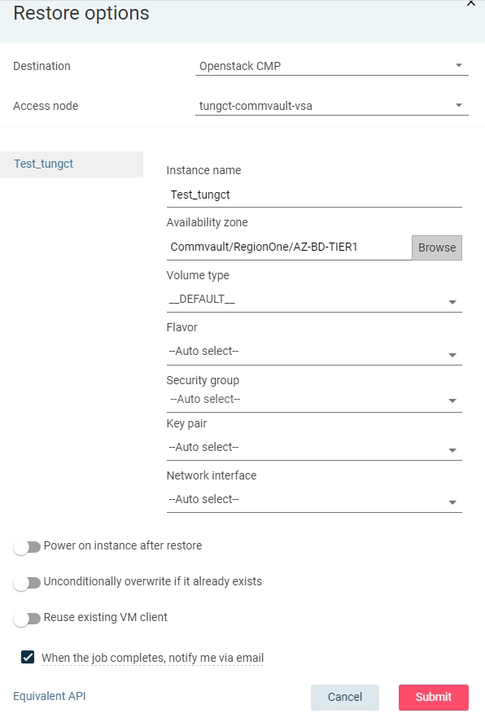

| Trường                | Ý nghĩa                                                                         | Gợi ý cấu hình                                                      |
|-----------------------|---------------------------------------------------------------------------------|---------------------------------------------------------------------|
| **Instance name**     | Tên của máy ảo được khôi phục.                                                  | Có thể giữ nguyên hoặc đổi để tránh trùng.                          |
| **Availability zone** | Vùng khả dụng trong OpenStack (ví dụ như RegionOne/AZ-BD-TIER1).                | Nên chọn zone trùng với nơi có tài nguyên compute.                  |
| **Volume type**       | Loại volume dùng để khôi phục đĩa (như `__DEFAULT__`, `ssd`, `ceph`, `lvm`...). | Nếu chưa có yêu cầu đặc biệt, giữ `__DEFAULT__`.                    |
| **Flavor**            | Cấu hình phần cứng VM (RAM, CPU, Disk).                                         | Nên chọn flavor phù hợp với VM gốc, hoặc tự chọn nếu biết thông số. |
| **Security group**    | Nhóm bảo mật của VM (quy định port nào mở).                                     | Thường chọn `default` hoặc nhóm custom nếu có.                      |
| **Key pair**          | SSH key để truy cập VM sau khi khôi phục.                                       | Chọn key sẵn có hoặc tạo mới trong OpenStack.                       |
| **Network interface** | Mạng mà VM sẽ kết nối.                                                          | Chọn network tương ứng trong OpenStack (VD: `private`, `public`).   |


```json
"destination": {
  "destClient": {
    "clientId": 21,
    "clientName": "tungct-commvault-vsa"
  },
  "inPlace": true,
  "isLegalHold": false
}
```


Tốt lắm 👍 — từ thông tin bạn đưa ra, mình có thể khẳng định ngay **client đúng để dùng trong VM restore** là:

> ✅ **`tungct-commvault-vsa`**

---

### 🔍 Giải thích vì sao chọn client này:

| Client name              | Vai trò                                                       | Dùng cho restore VM được không?                                       | Ghi chú                                                |
| ------------------------ | ------------------------------------------------------------- | --------------------------------------------------------------------- | ------------------------------------------------------ |
| **tungct-commserve-01**  | CommServe (máy quản lý trung tâm), Web Server, Command Center | ❌ Không                                                               | Dùng để điều phối job, không trực tiếp chạy restore    |
| **tungct-commvault-vsa** | Virtual Server Access Node (VSA Proxy)                        | ✅ **Được**                                                            | Đây chính là **VSA client**, dùng để backup/restore VM |
| **tungct-media**         | MediaAgent, File System, Network Gateway, v.v.                | ⚠️ Có thể hỗ trợ truyền dữ liệu, nhưng **không trực tiếp restore VM** | Dùng phối hợp để lưu/đọc data                          |

---

### 📘 Kết luận:

Cấu hình phần `"destination"` của bạn nên là:

```json
"destination": {
  "destClient": {
    "clientId": 21,
    "clientName": "tungct-commvault-vsa"
  },
  "inPlace": true,
  "isLegalHold": false
}
```

---

### 🧠 Tóm lại:

| Thành phần                             | Ý nghĩa                                                      |
| -------------------------------------- | ------------------------------------------------------------ |
| `"clientName": "tungct-commvault-vsa"` | VSA proxy thực hiện restore                                  |
| `"inPlace": true`                      | Restore đè lên VM gốc                                        |
| `"isLegalHold": false`                 | Không ở chế độ pháp lý chỉ đọc                               |
| `"clientId": 21`                       | ID tương ứng với client đó (bạn có thể lấy từ API `/Client`) |

---

Nếu sau này bạn muốn restore **sang môi trường khác (Out-of-Place)** — ví dụ vCenter DR hoặc host khác — thì bạn chỉ cần đổi `clientName` sang VSA proxy ở site đó (ví dụ: `drsite-vsa-proxy`), đồng thời `"inPlace": false`.

---

Bạn muốn mình chỉ luôn ví dụ cấu hình JSON **Out-of-Place VM Restore** (restore sang VM mới khác tên) cho dễ so sánh không?
